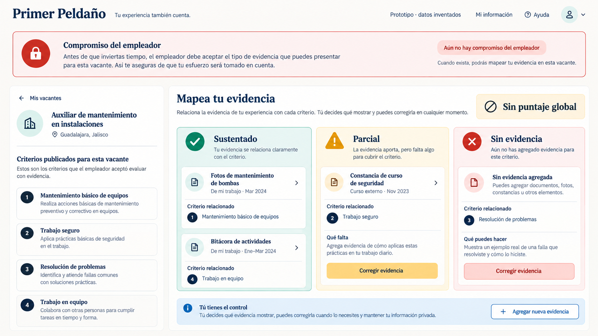
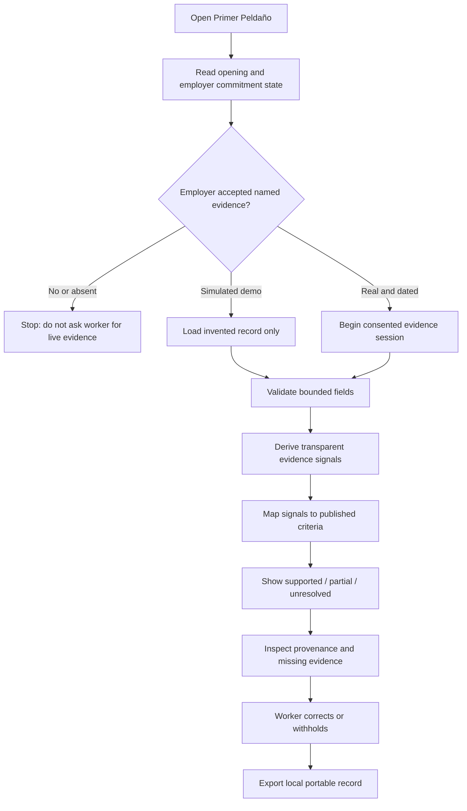
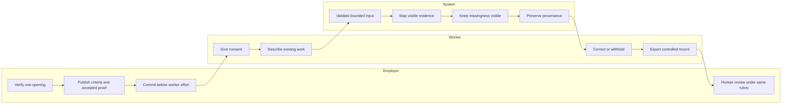

# Week 12 Venture Packet - Primer Peldaño

## Packet before code

This packet was finalized before the Week 12 rebuild. The binding product decisions live in [PRODUCT_CHARTER.md](./PRODUCT_CHARTER.md).

## Problem in my words

People can perform useful work for decades and still be rejected because the proof comes from an informal, unfamiliar, or uncertified setting. The product problem is not to generate a better CV or to award a score. It is to make one employer say, in advance, what evidence it will accept for one opening, then help the worker present only the evidence that actually supports those criteria.

## Exact user

An experienced worker in Mexico whose existing work is overlooked because it lacks familiar credentials or employer provenance. The reported current case informs the need, but the public prototype uses invented records until consent and an employer acceptance commitment exist.

## Success definition

Before the Week 12 module closes, the public Primer Peldaño URL lets a visitor complete one invented flow: inspect a simulated employer commitment, edit bounded work evidence, map visible evidence to four published criteria, see supported / partial / unresolved states, inspect provenance, correct the record, and export a local copy. The same input must always produce the same result, and no output may contain a global score or hiring prediction.

## Image-generated mockup

The following direction-setting mockup was generated before implementation. It is not evidence that the feature works. It uses invented content and deliberately foregrounds the commitment gate, criterion states, worker control, and the absence of a global score.

## Feature flow

## Actor swimlane

## Benchmark line

**Best existing solution on Earth:** Opportunity@Work's STARs ecosystem is the strongest benchmark for changing employer practice around workers Skilled Through Alternative Routes; its skills-first guidance begins with removing unnecessary credential filters, articulating skills, and evaluating candidates on those skills.

**How Primer Peldaño differs or localizes:** it narrows that systemic change to one Mexico-localized transaction: before a worker prepares evidence, one employer must accept named proof in place of prior formal experience for one opening; the worker reuses existing work, controls the record, and never receives a global rank.

The OECD's 2026 skills-first work supports the translation problem: workers struggle to describe capabilities in terms employers interpret reliably, while employers continue to use indirect proxies such as titles, years of experience, and credentials.

Primary sources:

- [Opportunity@Work - Implement skills-first hiring](https://www.opportunityatwork.org/topics/skills-first-hiring)
- [Opportunity@Work - Government as Employer Playbook](https://www.opportunityatwork.org/take-action/psh/government-as-employer-playbook)
- [OECD - Building a common skills language](https://www.oecd.org/en/publications/a-skills-first-labour-market_2e1b85f0-en/full-report/building-a-common-skills-language_8148eb1f.html)

## Three-year long view

If this slice works, Primer Peldaño becomes shared infrastructure through which employers, universities, and community organizations translate existing informal work into worker-controlled evidence for real openings. Employers publish reusable criterion templates and acceptance commitments, while independent reviewers audit quality, appeals, labor treatment, and 90-day employment outcomes. The product succeeds only if it expands mobility without turning candidates into unpaid test workers or reducing people to opaque scores.

## Scope cut

This week does not build a CV builder, job board, candidate marketplace, ranking, credential, identity-verification service, background check, payroll flow, hiring decision, new work assignment, course, unpaid audition, or production LLM. It does not publish the reported worker's story or assert that an employer has committed. It does not claim 10:1 value.

## Architecture and free stack

| Layer | Choice | Boundary |
|---|---|---|
| App | Next.js + React + TypeScript | One responsive public flow, server-rendered shell, client-side interaction. |
| Styling | Tailwind CSS | Accessible design tokens and responsive layout. |
| Data | Supabase client boundary | Optional opening/commitment persistence only after RLS and environment configuration; public demo does not store data. |
| Logic | Deterministic TypeScript rules | Transparent mapping from visible evidence; no prediction or global score. |
| Hosting | Vercel | Public venture-identity URL and repeatable production deployments. |
| Source | GitHub | Minimum five auditable Week 12 commits. |
| Security | Invented demo data, input limits, sensitive-pattern blocking, no secret in repository | No personal data is accepted or stored in the public demo. |

## Test plan

### Mechanical pass

1. Unit-test required fields, length limits, sensitive-pattern blocking, deterministic mapping, provenance, and minimized export.
2. Run type checking, lint, and the production build.
3. Deploy the first working slice and verify the public URL.
4. Complete the flow at desktop and mobile widths; find and document at least one defect.
5. Fix the defect, rerun all checks, redeploy, and verify the final URL.
6. Scan tracked files for secrets and unsupported claims.

### Persona pass

Use a fresh synthetic persona based on an invented mid-career worker who reads slowly on a phone, uses WhatsApp, distrusts hiring platforms, and worries that informal work does not count. Show each screen in order, record every hesitation, and fix the highest-severity confusion. Do not claim this substitutes for a real worker test.

## Acceptance criteria

- The commitment state is visible before evidence input.
- A missing real commitment blocks any implied live-worker use; the demo is labeled simulated.
- Empty, over-length, or sensitive-looking text cannot be analyzed.
- Statuses derive only from visible evidence and update after edits.
- Every supported or partial result cites visible provenance.
- Every unresolved criterion names what is missing.
- No aggregate candidate score, rank, recommendation, certification, verification, or hire prediction appears.
- The worker can correct the input and export a local record.
- Supabase remains disabled unless its public configuration exists; no service secret is shipped.
- The final Vercel URL returns the tested production build.

## Unresolved gates

The employer commitment, consented worker evidence, comparable 10:1 measurement, and actual human review remain unresolved. They are the next decisive field test, not claims the software can manufacture.
