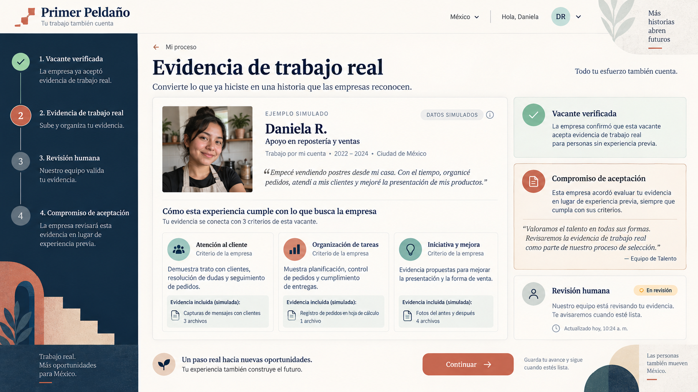
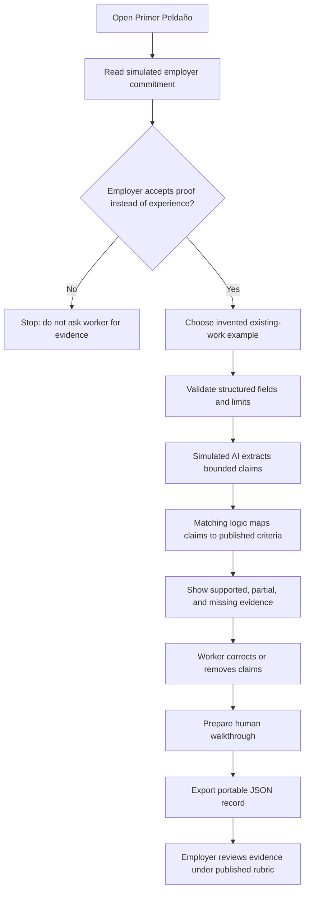
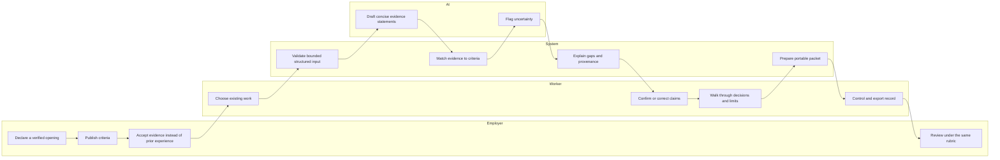

# Primer Peldaño - Week 9 build packet

**Owner:** David Buzali  
**Course:** Business Bending, Week 9 - When the work goes away and the first rung disappears  
**Blueprint vacuum:** FIRST-PROOF  
**Status:** packet before code

## The problem, in my words

A young person in Mexico can already have done demanding, useful work - selling food, coordinating family-business orders, organizing community logistics - and still be filtered out of an entry-level opening because that work is informal and therefore illegible to an employer. Another course, certificate, or unpaid audition does not solve the filter. The missing first rung is an employer-approved way to turn work that already happened into criterion-level evidence for one real opening.

Primer Peldaño tests that bridge. It asks an employer to declare, before a worker invests effort, which evidence it will accept instead of prior formal experience. It then helps the worker structure existing work, maps that evidence to the declared criteria, exposes gaps, and prepares a portable record for a short human walkthrough. AI assists with organization and plain language; it does not certify truth, authorship, fairness, or employability.

## Exact user

Daniela is 22, lives in Mexico City, and helps sell desserts from home. She coordinates orders through WhatsApp, handles changes, tracks deliveries, and has improved how products are presented. She reads comfortably on a phone but has never translated that work into employer language. She is applying to one invented, verified **Auxiliar de operaciones** opening whose employer has agreed, for this simulated pilot, to accept specified evidence instead of one year of prior formal experience.

Secondary actor: a hiring manager who needs a transparent, auditable way to review the same criteria for every candidate without adding an unpaid work test.

## Success definition

Before the module closes, a person using the live URL can:

1. Select an invented work example without entering personal data.
2. See the employer's simulated proof-acceptance commitment before doing any work.
3. Run a labeled simulated-AI analysis that maps structured evidence to every published criterion.
4. Understand why each criterion is supported, partial, or missing, including the limits of the evidence.
5. Prepare a portable JSON record and a human-walkthrough checklist without creating a global score or promise of employment.

Success for this week's slice is **workflow completion and explainability**, not a hire. The 90-day formal-employment outcome remains the product-level success metric and cannot be claimed by this prototype.

## Image-generated mockup

The following screen was generated with OpenAI image generation before implementation. It is a direction-setting mockup, not evidence that the feature works. All people, companies, openings, and records shown are invented.

## Feature flow

## Actor swimlane

## Benchmark line

**Best existing solution on Earth:** Opportunity@Work's STARs ecosystem is the strongest benchmark because it combines research, employer practice change, and tools that make skills learned through alternative routes visible instead of relying on degrees alone ([Opportunity@Work](https://www.opportunityatwork.org/), [Government as Employer Playbook](https://www.opportunityatwork.org/take-action/psh/government-as-employer-playbook)).

**How mine differs or localizes:** Primer Peldaño narrows that system change to one Mexico-localized transaction: before evidence is prepared, one employer must accept named proof in place of prior experience for one verified opening; the worker reuses existing work first, controls the record, and never receives a global rank.

The OECD's 2026 review reinforces the design choice: work-sample tests are more predictive than years of similar experience, yet validation and employer trust remain major adoption obstacles ([OECD, A Skills-First Labour Market](https://www.oecd.org/en/publications/a-skills-first-labour-market_2e1b85f0-en/full-report/promoting-skills-first-hiring-and-talent-management_81392a48.html)).

## Three-year long view

If this slice works, Primer Peldaño becomes shared infrastructure through which universities, employers, and community organizations translate existing informal work into worker-controlled, signed evidence for real openings. Employers publish reusable criterion templates and acceptance commitments, while independent reviewers audit quality, appeals, labor treatment, and 90-day formal-employment outcomes. The product succeeds only if it expands mobility without turning candidates into unpaid test workers or reducing complex people to opaque scores.

## Scope cut

This week does **not** build:

- a CV builder, job board, application marketplace, or candidate ranking;
- a new work project, internship, course, certificate, or unpaid audition;
- real employer, worker, IMSS, university, or identity verification;
- authentication, a database, background checks, payroll, or hiring decisions;
- a prediction of displacement, job success, authorship, or 90-day retention;
- a production LLM integration or claim that simulated output is intelligent.

## Blueprint conditions and shadow clause

| Blueprint condition | This slice's implementation |
|---|---|
| User fit | Starts from existing work; all examples are invented; no travel or forgone earnings required. |
| Employer filter | Shows a simulated written commitment before evidence collection and publishes the four criteria. The app stops conceptually if that commitment is absent. |
| Payer and outcome | Employer is the hypothesized payer. The interface names the 90-day formal-employment checkpoint but claims no ROI or hire. |
| Shadow clause | No rescue simulation, enrollment metric, new audition, debt, or global rank. Worker can correct, omit, and export the record. |
| Technology honesty | AI output is explicitly simulated. Matching is deterministic and explainable. Human review remains required. |
| Operational stop | One opening, no new projects, no live work, no repeated auditions. Production must verify labor classification before any paid slice. |

## Architecture and stack

| Layer | Choice | Why |
|---|---|---|
| Interface | React 19 + TypeScript + Vite | Fast, accessible, responsive static slice. |
| LLM layer | Deterministic simulated-AI claim drafting | Demonstrates the interaction without a secret, cost, or false production claim. |
| Structured / verified data | Versioned invented opening, criteria, issuer, acceptance commitment, and evidence provenance | Makes every output traceable; “verified” describes the schema and simulated issuer state, not real-world truth. |
| Additional Dragon Stack layer | Transparent criterion matching | Maps evidence tags to published criteria and explains supported, partial, or missing status. |
| Portability | Browser-generated JSON download | Worker controls a local record; nothing is uploaded or stored. |
| Security | No secrets, no database, no accounts, strict length/type validation, invented data only | Avoids collecting personal data and meets the Week 9 security floor for the prototype. |
| Hosting | Vercel static deployment | Free public URL and repeatable deployment. |

## Data model

Each record includes: schema version; invented worker and opening IDs; employer acceptance commitment; published criteria; evidence items with type and provenance; bounded AI-drafted claims; deterministic matches and reasons; unresolved gaps; human-review state; correction history; and an explicit simulated-data flag. It excludes phone numbers, emails, government IDs, addresses, passwords, financial details, health data, and free-form uploads.

## Test plan

### Mechanical pass

1. Run unit tests for validation, claim extraction, criterion matching, and export minimization.
2. Run the production build with TypeScript checks.
3. Confirm the first deploy works at its public URL.
4. Complete the entire Daniela flow on desktop and mobile-sized layouts.
5. Intentionally find and document at least one defect, fix it, rerun tests, and redeploy.
6. Confirm no repository file contains a secret and no UI claim implies a real employer, real verification, guaranteed hire, or production LLM.

### Persona pass

Use a fresh chat with **Daniela, 22**, an invented Mexico City informal food seller who uses WhatsApp daily, distrusts unfamiliar hiring platforms, reads carefully but abandons tasks when requirements feel hidden, and worries that her work “doesn't count.” Show the persona each screen in order, record every hesitation, and fix the highest-severity confusion before the final deploy.

### Acceptance criteria

- A user cannot run the analysis with missing required fields or over-length text.
- The acceptance commitment and the simulated-data label appear before the action button.
- The same input always produces the same match statuses and reasons.
- No output includes a global candidate score or employment prediction.
- Every supported claim cites at least one evidence item; every missing criterion names what is missing.
- The portable export contains only the invented example, structured claims, matches, and provenance.
- Keyboard focus reaches the result after analysis; controls have accessible labels and visible focus states.
- The final public URL returns the tested production build.

## Kill criteria

Do not proceed to a real pilot if employers will not sign acceptance commitments before workers prepare evidence; if reviewers cannot apply the rubric consistently; if workers cannot correct or withhold the record; if the evidence process becomes longer than the application it replaces; or if measured hiring outcomes are reduced to enrollment, completion, or certificate counts.
